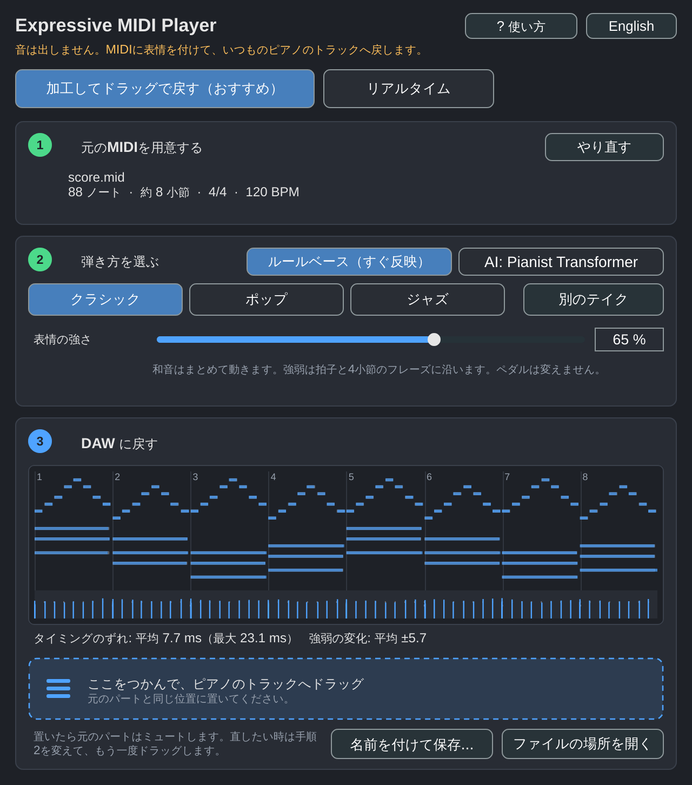
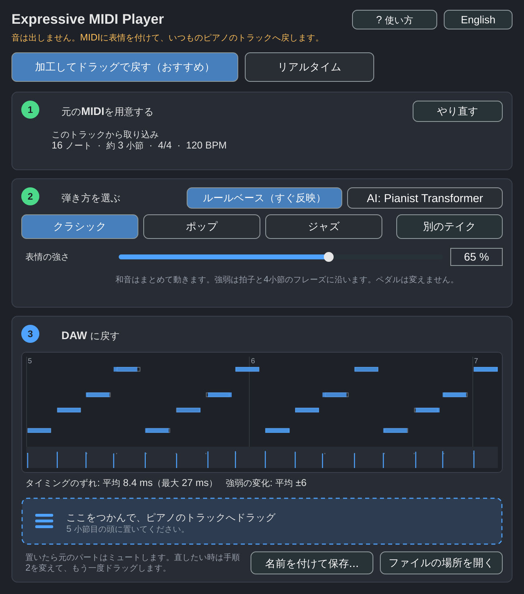

# Expressive MIDI Bridge 1.0 — Piano

**Purpose:** Change *how a MIDI piano score is performed* while keeping your existing Fender Studio Pro / Kontakt / Pianoteq / other piano instruments. It outputs MIDI with timing, velocity, duration and optional sustain-pedal changes. It does **not** generate piano audio, and it does not modify recorded WAV files.

The project has two separate components:

1. **Offline expressive MIDI application** (Python CLI + small graphical UI): transforms MIDI; can invoke the upstream **Pianist Transformer** open-source model if installed locally. In environments without the model, a deterministic **non-AI baseline** works immediately.
2. **VST3 MIDI player** (JUCE/C++ sources): loads the output MIDI, sends MIDI to a separately routed instrument track in Fender Studio Pro, and follows transport position. It is intentionally a *MIDI-output instrument* in VST3 rather than a VST3 MIDI effect. It has no built-in sound engine.

## Downloads, continuous integration and releases

- [GitHub Actions — latest builds](https://github.com/KTakahiro1729/Expressive-MIDI-Bridge/actions/workflows/build.yml): open a successful run, then download an artifact from **Artifacts** (GitHub login may be required). Artifacts are retained for 30 days.
- [GitHub Releases — permanent downloads](https://github.com/KTakahiro1729/Expressive-MIDI-Bridge/releases): every fully successful push build on `main` publishes downloadable Windows/macOS VST3 ZIPs and Python packages as a `ci-*` prerelease. A `v*` tag additionally publishes a versioned release after all build jobs pass.

**Important:** The VST3 ZIP contains a **MIDI-output plugin**, not an AI model or piano instrument. It plays a previously generated MIDI file and must send its MIDI to a separate instrument track in the host. Whether Fender Studio Pro supports the required VST3 MIDI-out routing must be checked in the actual host. The macOS bundle is unsigned/not notarized. The actual build results and download availability are authoritative in GitHub Actions; unsigned VST3 bundles are not validated in Fender Studio Pro.

### CI/CD behavior

Every push to `main` and every pull request runs Python tests, a CLI smoke test, a C++ scheduler test, builds Python distributions, and attempts VST3 builds for Windows and macOS. All downloads are attached as workflow artifacts only when their jobs pass. A fully successful `main` build automatically publishes permanent `ci-*` GitHub Release assets. A version tag such as `v1.0.0` additionally publishes a versioned release after **all** builds pass. AI model weights are not bundled or downloaded on CI; AI inference needs upstream setup (section 3).

For an existing VST3 build, unzip the appropriate platform package, install the `.vst3` bundle to your operating system's VST3 directory, restart/rescan the DAW, and route MIDI output to the desired piano instrument. On Windows, the usual per-user directory is `%LOCALAPPDATA%\Programs\Common\VST3` or the system-wide `C:\Program Files\Common Files\VST3`; on macOS `~/Library/Audio/Plug-Ins/VST3` or `/Library/Audio/Plug-Ins/VST3`. Installation requires testing with your host.

## 1. Verified functionality vs remaining checks

| Item | Status |
|---|---|
| MIDI file read/write, fixed-tempo conversion, baseline interpretation | Executed: Python unit and CLI tests pass |
| AI expression/score blend, pitch/count validation, model/score pedals | Executed: synthetic performance tests pass |
| Pianist Transformer adapter API/signature | Matched upstream published `src.model.generate` and `src.inference.inference`; mock-backed contract test passes |
| **Real Pianist Transformer model inference** | **Not tested here**: upstream model code/dependencies/270 MB weights unavailable in this isolated environment. Install locally. |
| C++ MIDI scheduler, frame/beat timing | Compiled and executed with `c++ -std=c++17`; tests pass |
| VST3 dynamic library | Compiled on Linux with JUCE 8.0.10; Windows/macOS built by CI |
| **Fender Studio Pro real host** | **Not tested**: host unavailable here. |

**Do not mistake the baseline for AI.** The AI backend is `pianist-transformer` and requires the real upstream fine-tuned checkpoint, *not* the base pre-trained model.

## 2. Use immediately without AI or VST3

Supported: Python 3.10+ with a local pip installation. From the extracted project root:

```bash
python -m pip install -e .
python -m expressive_midi demo -o demo/score.mid
python -m expressive_midi render demo/score.mid demo/performance_baseline.mid \
  --backend baseline --strength 0.75 --daw-bpm 120 --report
```

The output is **an ordinary MIDI file**. In Fender Studio Pro, create an Instrument Track, choose the piano sound you already own, set the session to 120 BPM and import `demo/performance_baseline.mid`. The new file changes MIDI performance data, not the instrument sound.

To open a simple UI instead:

```bash
python -m expressive_midi.gui
# or, after pip installation:
expressive-midi-gui
```

The UI renders on a background worker (so it remains responsive). Choose a MIDI input/output, the backend, and the desired DAW BPM. The default **baseline** is a non-ML fallback.

## 3. Enable the actual Pianist Transformer model

Official repository: https://github.com/yhj137/PianistTransformer

Fine-tuned checkpoint: https://huggingface.co/yhj137/pianist-transformer-rendering (Apache-2.0 model card; ~272 MB)

The AI runs as an **external Python 3.11 process**. Requires network access for first setup and several GB of disk space for PyTorch and dependencies. Do not run inference inside the audio thread.

### Option A: Setup scripts (macOS/Linux or Windows PowerShell)

On macOS/Linux, with Python 3.11 and git installed:

```bash
bash scripts/setup_ai.sh "$HOME/PianistTransformer"
```

On Windows PowerShell, with `py -3.11`, git, Python/pip and CMake available:

```powershell
./scripts/setup_ai.ps1 -Repository "$HOME\PianistTransformer"
```

These scripts clone the official upstream repository, create a separate venv, install upstream's pinned `requirements.txt`, and run its official weight download. Review scripts before running; they fetch and install third-party code. Torch may require a platform-specific installation, especially for NVIDIA CUDA. The upstream README takes precedence if a dependency changes.

### Option B: Manual setup

Follow the commands at https://github.com/yhj137/PianistTransformer to clone, install requirements and run:

```bash
python -m src.utils.download_model --source huggingface
```

Verify these files exist under `PianistTransformer/models/sft/`:
`config.json`, `generation_config.json`, `model.safetensors`.

### Diagnostic command

Replace the paths with your actual installation:

```bash
python -m expressive_midi doctor \
  --repo "$HOME/PianistTransformer" \
  --model-python "$HOME/PianistTransformer/.venv/bin/python"
```

`doctor` reports each precondition as JSON. Exit code `0` means the file checks and Python import checks passed; **it does not verify generation quality or inference success**. On Windows the AI Python executable is usually `...\.venv\Scripts\python.exe`.

### Generate the AI performance

macOS/Linux example (the output is directly ready for a DAW at 120 BPM):

```bash
python -m expressive_midi render demo/score.mid demo/performance_ai.mid \
  --backend pianist-transformer \
  --repo "$HOME/PianistTransformer" \
  --model-python "$HOME/PianistTransformer/.venv/bin/python" \
  --daw-bpm 120 \
  --ai-strength 1.0 \
  --pedal model \
  --device cpu \
  --report
```

If the AI version feels excessive, set `--ai-strength 0.5` to mix model and score note timings, velocities and durations. `--pedal model` uses AI-generated CC64, `--pedal score` preserves the score's CC64, and `--pedal none` omits sustain CC64. A strength of 0 uses the score's CC64 by default; no AI expression is blended. For `--device cuda`, ensure your model venv has the correct CUDA build of PyTorch. `mps` is also accepted when supported on macOS.

An explicit ``--daw-bpm`` is recommended for use with the VST3 player, as the plugin reads PPQ event positions and follows the host BPM. In a 120 BPM session use `--daw-bpm 120`.

**AI accuracy guard:** output must contain the same count of notes *at each MIDI pitch* as the input. If it does not, the blender fails with an error instead of modifying the wrong note. Notes are aligned in chronological order *within each pitch*. This works for most score-aligned rendering but may not represent every overlapping/rearticulated or multi-instrument MIDI arrangement correctly. Work with one piano score at a time. The upstream renderer itself can error on unsuitable or extremely short scores.

## 4. Build the VST3 player (Windows / macOS)

The repo includes a JUCE 8 **MIDI-output instrument**. It deliberately reports `IS_SYNTH TRUE` and `IS_MIDI_EFFECT FALSE`, and provides a silent stereo audio bus. This configuration is used for routing MIDI out of VST3 in Studio One-family hosts; VST3 MIDI FX on the same track is not reliably supported.

Requirements: a C++17 compiler, CMake >=3.22, a working native VST3 toolchain, and Internet access on first configure (downloads JUCE 8.0.10), or a local JUCE checkout.

```bash
# macOS/Linux:
bash scripts/build_vst.sh
# Or offline when you already have JUCE sources:
bash scripts/build_vst.sh -DJUCE_ROOT=/path/to/JUCE
```

```powershell
# Windows PowerShell:
./scripts/build_vst.ps1
# Or use an existing JUCE checkout:
./scripts/build_vst.ps1 -JuceRoot 'C:\SDKs\JUCE'
```

A successful build creates an `Expressive MIDI Player.vst3` bundle under `build/vst3` (exact subfolder varies by OS/build system). Install the bundle in your OS's VST3 directory and have Fender Studio Pro rescan plug-ins:

- Windows: `%CommonProgramFiles%\VST3`
- macOS: `/Library/Audio/Plug-Ins/VST3` or `~/Library/Audio/Plug-Ins/VST3`

JUCE license: its open-source/paid licensing rules apply **in addition to** this project's MIT license; check https://juce.com/legal before redistributing a binary.

### Fender Studio Pro routing (host-side verification required)

1. Add **Expressive MIDI Player** as a new virtual instrument on an instrument track. This track produces **silence** and MIDI events, not piano audio.
2. Select the **Play a MIDI file (legacy)** tab, then load your processed fixed-BPM `.mid` with **Load MIDI file…** or by dragging it onto the plugin window.
3. Add a **second instrument track** with your piano VSTi / Fender instrument. Choose the MIDI output of **Expressive MIDI Player** as the **input** for that track, if the host exposes it. Enable monitoring and route the sound source to your main audio bus.
4. Play from the beginning of the session. Use **Start position (beats)** to shift the clip forward (0 = bar 1 in a standard 4/4 session; 4 = start at bar 2). Use **Reload** after regenerating the `.mid`.

The plugin retains the MIDI bytes inside the DAW project state (up to 32 MB), so the loaded clip does not depend only on an absolute file path. Reload uses the original path when available.

**Important:** Fender Studio Pro has not been run in this environment. VST3 MIDI output is host-specific. If the plugin does not appear as an input on the second track, use the robust **direct MIDI file import method** in §2; it works with any compatible instrument, does not need plug-in MIDI routing, and is the preferred first test.

**Transport/pedal caveats:** The player schedules events at transport PPQ beats. It does not interpret source MIDI tempo changes (flatten before loading). On playback stop, seek and clip replacement it sends note-off/reset-controller messages; controller CC64 and certain VST3 MIDI CCs are subject to host support. Starting playback in the middle of held notes does not reconstruct the earlier note-on or pedal state. Changes in host tempo during a single processing block are approximated by that block's BPM. Export or render the generated MIDI on the destination instrument track for repeatable offline bounce.

## 5. Test / development

```bash
python -m pip install -e . pytest
python -m pytest -q
# Toolchain-independent scheduler component:
c++ -std=c++17 -Wall -Wextra -Werror tests/scheduler_test.cpp -o /tmp/expressive-scheduler-test
/tmp/expressive-scheduler-test
c++ -std=c++17 -Wall -Wextra -Werror tests/clip_model_test.cpp -o /tmp/expressive-clip-test
/tmp/expressive-clip-test
```

The Python test suite includes conversion invariants, AI/score blending, CC64 semantics, tempo mapping, mismatch errors, a real CLI invocation and a **mock** of the upstream API (the mock does not run the pretrained model).

Component layout:

```text
expressive_midi/
  core.py              baseline + MIDI tempo conversion
  postprocess.py       merge AI performance with the score
  integrations/runner.py  upstream model runner (separate environment)
  cli.py               CLI / doctor
  gui.py               optional Tk GUI
vst3/JuceMidiPlayer/  JUCE MIDI-output VST3 source
  Source/MidiScheduler.h  dependency-free, tested scheduling function
scripts/               model setup / VST build helpers
tests/                 Python tests + standalone C++ scheduler tests
demo/                  original and baseline MIDI
```

## 6. Design limitations and origin

The AI source + weights are intentionally **not bundled**, because a reproducible setup depends on the host OS/GPU, upstream dependencies and their respective licenses. The model wrapper currently follows the upstream API as it existed on 2026-11-02. No actual pretrained-model inference or native DAW integration was possible in this environment. These are remaining verification steps, not features silently simulated by the included baseline.

The independent portions of this repository are under the MIT license (see `LICENSE`). All external downloads (Pianist Transformer, JUCE, VST3 SDK and audio instruments) retain their separate licenses. This is a development deliverable, not a code-signed plug-and-play Windows/macOS installer.

References:
- Pianist Transformer README: https://github.com/yhj137/PianistTransformer
- Pianist Transformer inference code: https://github.com/yhj137/PianistTransformer/blob/main/src/inference/inference.py
- P.T. rendering checkpoint: https://huggingface.co/yhj137/pianist-transformer-rendering
- JUCE CMake API: https://github.com/juce-framework/JUCE/blob/master/docs/CMake%20API.md
- VST3 MIDI-out host behavior: https://forum.juce.com/t/vst3-midi-audio/62624/14
- Fender official virtual instrument routing manual: https://fenderstudiopromanual.fender.com/en/Content/Recording_Topics/Instrument_Tracks.htm

## Live MIDI directly from a Fender Studio Pro track (v1.1)

Since v2.0 this mode is the **Real-time** tab (new instances start in the clip workflow described below). It still requires host MIDI-out routing.

1. Create an instrument track with **Expressive MIDI Player** as its instrument.
2. Put (paste, drag, record) the existing piano MIDI part directly on **that Player track**.
3. Create a **second** instrument track with the piano VSTi or built-in piano instrument.
4. In the piano track's Inspector (F4), select **Expressive MIDI Player** as its Instrument Input (if Fender exposes the VST3 MIDI output). Enable input monitoring on the piano track.
5. Start playback. Adjust the **Humanize strength**, **Timing**, and **Velocity range** in the player. At 0% strength, notes are passed through unchanged. No manual MIDI file loading is required.

For an **existing piano track**, keep its instrument but move/copy its MIDI part to the Player track. Mute the original MIDI part to avoid duplicated notes. This is a non-destructive source-clip workflow: the original MIDI remains editable on the Player track. The Player does **not** insert into Fender's native Note FX rack. Generic VST3 MIDI effects do not have the same-track Note FX routing available to proprietary Fender Note FX processors.

The live settings use **rule-based deterministic timing delay and velocity variation**, not Pianist Transformer. The model-backed AI engine remains an offline Python path requiring additional development for automatic in-DAW capture and phrase generation. Timing changes are positive delay only (0-40 ms; set to 0 to disable). Note lengths and pedals remain unchanged in live mode. Live-note queue capacity is 4096; excess events pass through unchanged. Fender host MIDI-out routing still requires an actual host test.

In the Source dropdown, **External MIDI file (legacy)** retains the old file-player behavior for projects that used it. Both modes store settings in the DAW project.

## Recommended workflow in the plugin: make expressive & drag back (v2.0)

New plugin instances open in **Make expressive & drag back**. This workflow does **not** depend on VST3 MIDI-out routing, which is the least reliable part of the earlier setup. The result is ordinary MIDI that you place on your usual piano track (LABS, Pianoteq, Kontakt, a built-in instrument, anything).



1. **Bring in the MIDI**, either way:
   - export the part from the DAW as a `.mid` file, then drop it onto the plugin window (or click *Open*). User reports say that Studio One-based DAWs do not let you drag a part straight into a plugin window, hence the export step;
   - or put the part on the plugin's own track, click **Capture from this track** and play it in the DAW. Capture stops when you press Stop or when a loop jumps back. The result remembers the bar where it started.
2. **Choose how it is played.**
   - *Rule-based* (Classical / Pop / Jazz, expression 0–100 %, *Try another take*): updates instantly. It is a C++ port of the Python baseline (chord tones move together, bar accents, 4-bar phrase arc, slight duration changes; pitch, note count and pedal events are kept). The C++ random generator differs from Python's, so the same seed does not give note-identical output to the CLI.
   - *AI: Pianist Transformer*: the plugin runs `python -m expressive_midi render --backend pianist-transformer ...` as a separate process, so the DAW keeps running. One-time setup: run `scripts/setup_ai.sh` / `scripts/setup_ai.ps1` (it now also installs this package into the AI venv), then set **AI settings → PianistTransformer folder**. **Check environment** runs `doctor` and explains what is missing.
3. **Put it back into the DAW.** The panel shows a before/after piano roll with a velocity lane and the average and maximum timing shift. Drag the box onto your piano track. A captured clip has to be dropped at the start of the bar that is shown; a file should be dropped where the original part starts. Then mute the original part. If drag & drop does not work in your host, use **Save as...**. Every drag also writes the file to `Documents/Expressive MIDI Bridge/`.



The source clip, the settings and the last AI result are saved in the DAW project. AI paths are saved per computer in the user settings folder (`ExpressiveMidiBridge.settings`).

**Other modes.** *Real-time* is the v1.1 live humanizer (signal-flow panel, MIDI IN/OUT lamps, hints, presets). It still needs MIDI routing to a second track. The *File player (old)* tab is shown only for projects that already use it.

**Verified here (Linux, JUCE 8.0.10):** the VST3 builds; `tests/clip_model_test.cpp` passes (pairing, identity at 0 %, determinism, count/pitch/pedal preservation, chord grouping, no same-pitch overlap); a test harness took screenshots of the editor states, captured MIDI through `processBlock`, exported the result, and restored it from saved project state; the AI path ran end to end against a **fake** PianistTransformer repository (real subprocess, CLI and blending; no real model). **Not verified:** drag & drop into Fender Studio Pro, Windows/macOS behaviour, and real model inference.

Japanese text relies on JUCE 8's automatic font fallback to a system CJK font.
