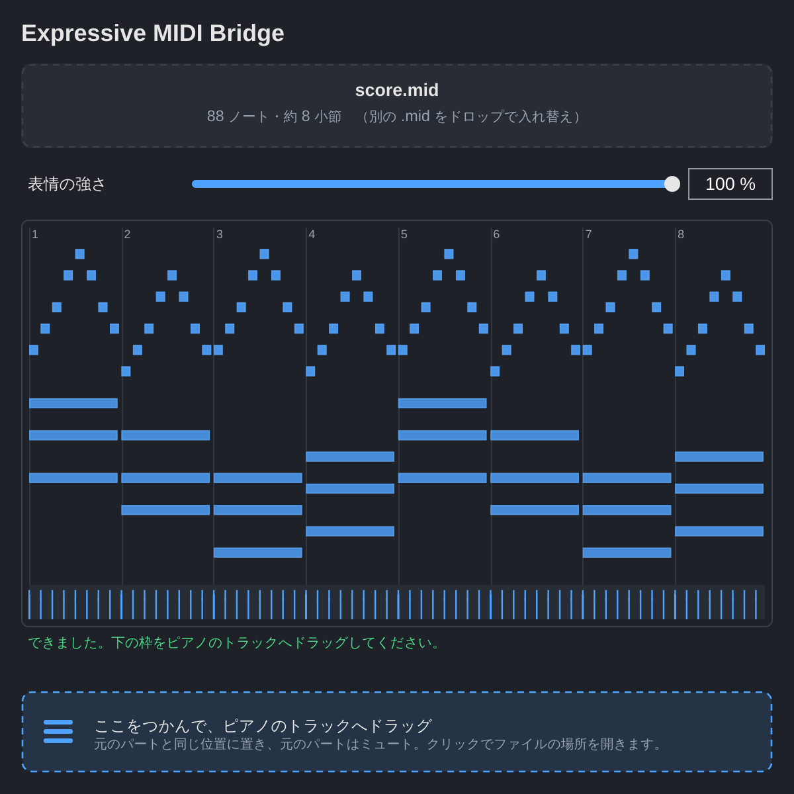
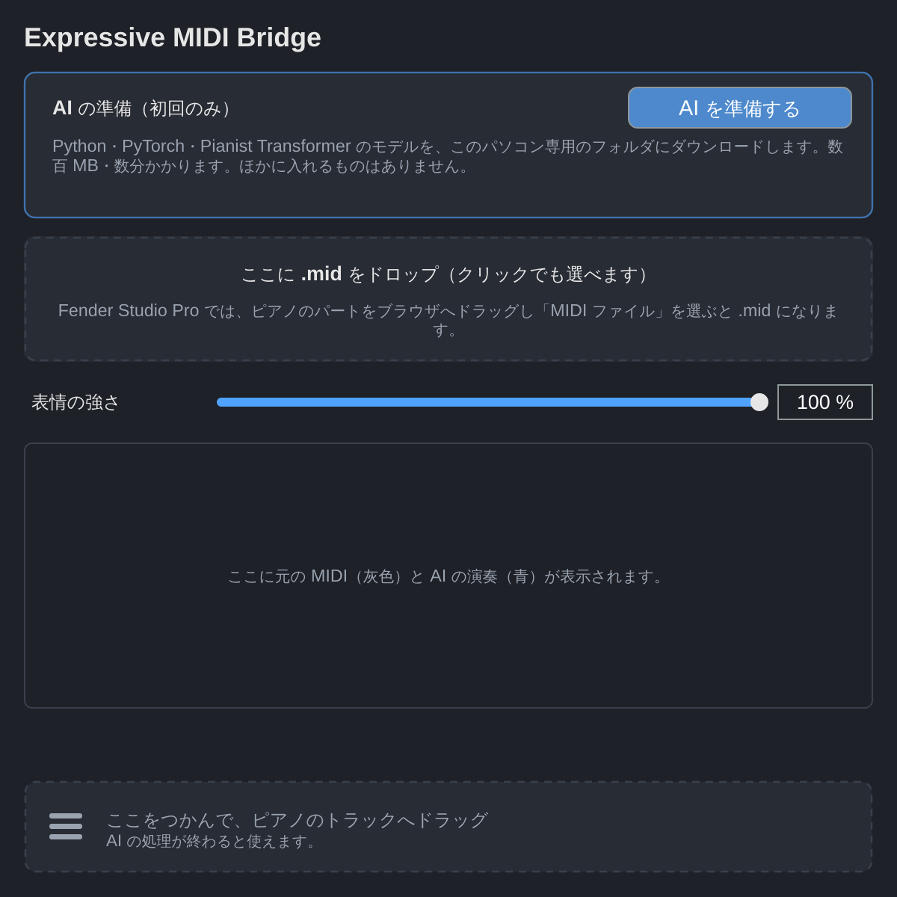

# Expressive MIDI Bridge

ピアノの MIDI のタイミング・強弱・ペダルを [Pianist Transformer](https://github.com/yhj137/PianistTransformer) で書き換える VST3 プラグインです。音は加工しません。



## ダウンロード

- **Windows**: [Expressive-MIDI-Bridge-Windows.zip](https://github.com/KTakahiro1729/Expressive-MIDI-Bridge/releases/latest/download/Expressive-MIDI-Bridge-Windows.zip)
- **macOS (Apple Silicon)**: [Expressive-MIDI-Bridge-macOS.zip](https://github.com/KTakahiro1729/Expressive-MIDI-Bridge/releases/latest/download/Expressive-MIDI-Bridge-macOS.zip)

zip の中身は `Expressive MIDI Bridge.vst3` と `README.txt`（この下と同じ手順）だけです。

## インストール（1回だけ）

1. `Expressive MIDI Bridge.vst3` をフォルダごとコピーします。
   - Windows: `C:\Program Files\Common Files\VST3`
   - macOS: `/Library/Audio/Plug-Ins/VST3`
2. Fender Studio Pro を起動します。一覧に出ない時は **Options → Locations → VST Plug-ins → Reset Blocklist** を押して再起動します（[公式マニュアル](https://fenderstudiopromanual.fender.com/en/Content/Setup_Topics/Managing_Your_Content.htm)）。
3. ピアノのトラックの**インサート**に「Expressive MIDI Bridge」を挿して開き、**AI を準備する** を押します。

   

   Python・PyTorch（CPU 版）・モデルを、このパソコン専用のフォルダに自動で入れます。数百 MB、数分かかります。Python や Git を自分で入れる必要はありません。

## 使い方

1. ピアノのパートを **ブラウザへドラッグ** し、ポップアップで **MIDI ファイル** を選びます（初期値は Musicloop です。[公式マニュアル](https://fenderstudiopromanual.fender.com/en/Content/Editing_Topics/Audio_Loops_and_Music_Loops.htm)）。
2. できた `.mid` をプラグインの画面にドロップします。AI が自動で演奏を作ります（CPU だと数分かかることがあります）。
3. **表情の強さ** を調整します（100% = AI の演奏そのまま、0% = 元のまま）。AI はもう一度動かさないので、すぐ反映されます。
4. 下の枠をつかんで、ピアノのトラックへドラッグします。元のパートと同じ位置に置き、元のパートはミュートします。

ドラッグがうまくいかない時は、枠をクリックするとファイルの場所が開きます（`ドキュメント/Expressive MIDI Bridge`）。読み込んだ MIDI・AI の結果・強さはプロジェクトに保存されます。

## AI のファイルについて

| | |
|---|---|
| 保存先 | Windows: `%LOCALAPPDATA%\ExpressiveMidiBridge\ai` / macOS: `~/Library/Application Support/ExpressiveMidiBridge/ai` |
| 入るもの | [uv](https://github.com/astral-sh/uv) 0.11.32（SHA-256 を確認）、Python 3.11、PyTorch 2.7.1（CPU 版）、transformers 4.54.0、miditoolkit、Pianist Transformer のモデル [`yhj137/pianist-transformer-rendering`](https://huggingface.co/yhj137/pianist-transformer-rendering)（Apache-2.0） |
| 削除 | このフォルダを消すだけです |

推論に必要な本家のコード 3 ファイルは、`expressive_midi/_vendor/pianist_transformer/` に同梱しています（Apache-2.0、改変なし、コミット `747df2d`）。

## 確認できていること・いないこと

- **確認済み（Linux、JUCE 8.0.10）**: VST3 のビルド、C++ と Python のテスト、テスト用プログラムで画面の各状態を確認。インストーラーは実際にダウンロードして、uv の取得・チェックサム確認・Python 3.11 と venv の作成まで動作。読み込み → AI → 強さの変更 → 書き出し → プロジェクトの保存と復元は、**偽のモデル**で確認しました。
- **未確認**: Windows/macOS 上での動作、Fender Studio Pro へのドラッグ＆ドロップ、本物のモデルでの推論、PyTorch とモデルのダウンロード（作業環境から接続できなかったため）。
- macOS 版は署名されていません。読み込まれない時は `xattr -dr com.apple.quarantine "/Library/Audio/Plug-Ins/VST3/Expressive MIDI Bridge.vst3"` を実行してください。

---

## English

A VST3 plugin that rewrites the timing, velocity and pedal of piano MIDI with Pianist Transformer. Insert it on your piano track, press **Set up the AI** once (it installs a private Python environment and the model; nothing else to install), drop a `.mid` exported from the DAW, adjust **Expression**, and drag the result back onto the track. Audio passes through unchanged. Downloads: see the links above.

## For developers

```bash
# Python package and tests
python -m pip install -e . pytest
python -m pytest -q
c++ -std=c++17 -Wall -Wextra -Werror tests/clip_model_test.cpp -o /tmp/clip-test && /tmp/clip-test

# VST3 (Windows: ./scripts/build_vst.ps1)
bash scripts/build_vst.sh            # or: bash scripts/build_vst.sh -DJUCE_ROOT=/path/to/JUCE
```

Layout:

```text
vst3/JuceMidiPlayer/Source/
  PluginProcessor.*   pass-through audio effect, holds the session, saves state
  PluginEditor.*      the single screen
  AiEngine.*          AiRuntime (one-click installer) + AiSession (render once, re-blend on strength change)
  Widgets.*           before/after piano roll, drag-to-DAW handle
  ClipModel.h         MIDI note model for the preview (tested by tests/clip_model_test.cpp)
expressive_midi/
  ai_bridge.py        entry point the plugin runs: render / blend / check / download-model
  postprocess.py      blends the AI performance with the score at a strength and DAW tempo
  core.py, cli.py, gui.py, integrations/runner.py   command-line tools (non-AI baseline, external repo mode)
  _vendor/pianist_transformer/   upstream inference code (Apache-2.0)
packaging/README.txt  the README inside the download zip
```

The Python package is embedded in the plugin as a zip at build time and unpacked into the AI folder. CI (`.github/workflows/build.yml`) runs the tests and builds Windows/macOS on pushes to `main` and on pull requests; a successful `main` build is published as the latest GitHub Release (`publish.yml`), which is what the download links point to.

The command-line tools still work on their own (`python -m expressive_midi render ... --backend baseline|pianist-transformer`, `doctor`, `scripts/setup_ai.*`); see `python -m expressive_midi --help`.

## Licenses

This project: MIT (`LICENSE`). Bundled upstream code and the downloaded model: Apache-2.0. JUCE: see https://juce.com/legal before redistributing binaries. PyTorch, transformers and the other downloaded packages keep their own licenses.
